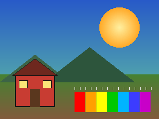
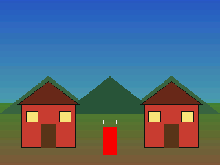
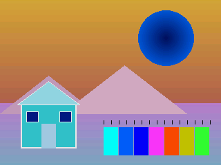
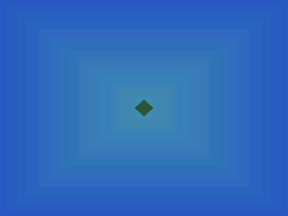
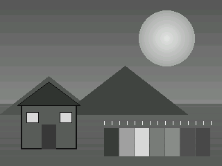
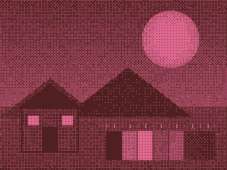
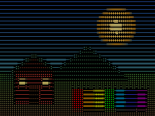
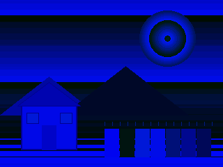
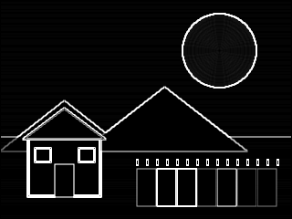
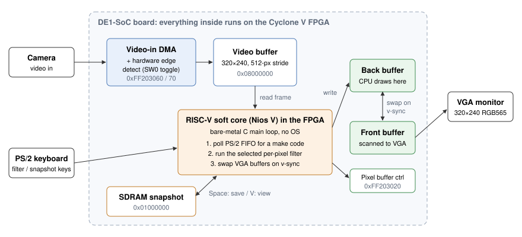

# Real-Time Camera Filter

**Live camera filters in bare-metal C on a RISC-V processor built into the FPGA of a DE1-SoC board.**

Everything runs on the board. A Nios V (RV32IM) RISC-V soft core is instantiated in the Cyclone V FPGA fabric, and our C program runs on it with no operating system. A camera feeds the board, a PS/2 keyboard picks the filter, and the RISC-V core processes every frame pixel by pixel and draws it to a VGA monitor in real time, talking to the camera, keyboard, VGA and memory directly through memory-mapped registers.


-orange)


## Filters

Every filter below runs live on the board's RISC-V core. The images here are the same filter code from `src/`, run on a test scene with the [host preview](#host-preview):

| Input | 1 · Mirror | 2 · Invert |
|:---:|:---:|:---:|
|  |  |  |
| **3 · Kaleidoscope** | **4 · Grayscale** | **5 · Duotone dither** |
|  |  |  |
| **6 · ASCII art** | **9 · Glitch** | **Sobel (software prototype)** |
|  |  |  |

| Filter | How it works |
|---|---|
| Mirror | Copies the left half of each row onto the right half, reflected around the centre |
| Invert | XORs every RGB565 pixel with `0xFFFF` |
| Kaleidoscope | Folds the top-left quadrant along its diagonal, then reflects it into all four quadrants |
| Grayscale | Integer luminance `Y ≈ (2R + 5G + B) / 8`, expanded back to RGB565 |
| Duotone dither | Luminance → contrast stretch → LCG noise → **4×4 Bayer ordered dither** → two-colour palette |
| ASCII art | Averages each 4×8 cell, maps brightness onto an 8-step character ramp (`.:-=+#@`), and stamps the glyph in the cell's average colour |
| Glitch | Writes 8-bit luminance straight into a 16-bit pixel, so brightness spills into the blue and green fields |
| Edge detection | SW0 turns on the edge-detect stage in the board's video-in pipeline; the 3×3 Sobel was first prototyped in software in CPULATOR |

## Controls

| Input | Action |
|---|---|
| `1` `2` `3` `4` `5` `6` `9` | Select a filter (any other key shows the raw camera feed) |
| `Space` | Save the current filtered frame to SDRAM (LEDR0 on) |
| `V` | Freeze the display on the saved snapshot (LEDR1 on) |
| `C` | Return to the live camera and discard the snapshot |
| `SW0` | Hardware edge detection on / off |

---

## How it works

### Architecture

<p align="center">
  
</p>

The whole system lives on the DE1-SoC. The FPGA is programmed with the DE1-SoC Computer system, which puts a Nios V (RV32IM) RISC-V soft core, the video-in DMA, the VGA pixel buffer controller and the PS/2 controller in the Cyclone V fabric. Our C program is compiled for RISC-V (`-march=rv32im_zicsr`), loaded onto that core over JTAG, and runs every frame in real time.

### The frame loop

`main()` runs on the RISC-V core as a single loop with no interrupts:

1. **Poll the keyboard.** `get_key()` checks the PS/2 FIFO's valid bit, skips `F0` (key release) and `E0` (extended) prefix bytes, and returns the make code. Filter keys are latched; mode keys (`Space`, `V`, `C`) act once.
2. **Run one filter over the frame.** The selected function reads the camera's frame buffer and writes every output pixel into the VGA **back buffer**.
3. **Swap buffers on v-sync.** `swapVGA()` writes the pixel buffer controller's swap register, then spins on its status bit until the swap happens at the next vertical sync. The monitor only ever scans a finished frame, so there's no tearing on the output.

### Pixel format and memory map

Frames are 320×240 in **RGB565** (5 bits red, 6 green, 5 blue). Rows are stored with a 512-pixel stride, so pixel `(x, y)` lives at `base + y*512 + x`.

| Region | Address |
|---|---|
| Camera frame buffer | `0x08000000` |
| VGA buffers A / B | `0x08100000` / `0x08200000` |
| Snapshot | `0x01000000` (SDRAM) |
| Pixel buffer controller | `0xFF203020` |
| Video-in DMA / edge detect | `0xFF203060` / `0xFF203070` |
| PS/2 | `0xFF200100` |

### Snapshots

`Space` runs the current filter one more time with the SDRAM snapshot region as its output, so the saved frame includes the effect. `V` switches the loop to copying that region to the screen instead of reading the camera, and `C` goes back to live.

### From prototype to live video

We started with a software 3×3 Sobel on a static grayscale image in the [CPULATOR](https://cpulator.01xz.net/) RISC-V simulator (`prototype/cpulator_sobel.c`). `tools/image_convert.py` resizes any picture to 320×240 grayscale and turns it into a C array for the simulator. Once the filters worked there, we moved to the real board with a live camera. On the board, edge detection uses the video-in pipeline's edge-detect stage, toggled from SW0, while the other filters run in C on the RISC-V core (see [known issue 1](doc/KNOWN_ISSUES.md) for the software Sobel).

The original plan is in [doc/proposal_block_diagram.png](doc/proposal_block_diagram.png).

---

## Host preview

`host/` builds the filter code from `src/` unchanged for a PC, runs every filter on a test scene, and writes the images in the gallery above, so filters can be tested without the board.

```
cd host
make gallery        # needs gcc and Python 3 with Pillow
```

`host/preview.c` packs the input into the board's RGB565 layout (same 512-pixel stride), calls each filter, and unpacks the result. To use your own picture, save it as a 320×240 binary PPM and run `./preview your.ppm build`.

## Repository layout

```
├── src/                 Board program (bare-metal C)
│   ├── main.c               Frame loop, key handling, snapshot modes
│   ├── filters.c/.h         Mirror, invert, kaleidoscope, ASCII, buffer swaps
│   ├── dither.c/.h          Luminance, grayscale, duotone dither, glitch
│   ├── input.c/.h           PS/2 keyboard driver
│   ├── config.h             Buffer addresses, register offsets, key codes
│   └── address_map.h        DE1-SoC Computer memory map
├── prototype/           Software Sobel on a static image (CPULATOR)
├── tests/ps2_keyboard/  Shows each key's make code on the HEX displays
├── tools/               Image to C-array converter
├── host/                PC build of the filters and gallery generator
└── doc/                 Diagrams, gallery, known issues
```

## Build and run

Requires an Intel FPGA 24.1 install with the FPGA Academy RISC-V tools, a DE1-SoC, a video camera input, a VGA monitor and a PS/2 keyboard. The Makefile runs on Windows (it uses `cmd.exe` and the bundled Cygwin).

```
cd src
make DE1-SoC      # program the board with the DE1-SoC Computer (Nios V)
make COMPILE      # build main.elf with riscv32-unknown-elf-gcc (-march=rv32im_zicsr)
make GDB_SERVER   # in one terminal
make GDB_CLIENT   # in another, to load main.elf onto the RISC-V core and run it
```

Set `INSTALL` at the top of `src/Makefile` to your Intel FPGA install path.

## Known issues

Four known issues, each with its cause and fix, are listed in [doc/KNOWN_ISSUES.md](doc/KNOWN_ISSUES.md). For example, the duotone palette scales green as a 5-bit field although RGB565 green is 6 bits, so the cream highlight renders pink.

## Credits and license

Built by [Haitham Ramadhan](https://github.com/Synx162) and [Albert Huang](https://github.com/dphhs).

`address_map.h`, the Makefile and `gdbopxdriscv.ini` come from the Intel FPGA Academy DE1-SoC Computer and Monitor Program templates. The hardware system (Nios V, video-in, pixel buffer and edge-detect cores) is the DE1-SoC Computer reference design.

MIT licensed. See [LICENSE](LICENSE).
